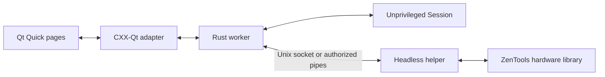

# Qt 6 desktop application

ZenTools now has an optional Qt Quick/QML frontend with a Rust backend using
CXX-Qt 0.10. The CLI remains usable without Qt.

## Build and run

Requirements: Rust 1.98+, a C++ compiler, LLD, Qt 6 development libraries and
tools for Core, Gui, Qml, Quick and Quick Controls, plus the QML Layouts and
Dialogs modules. The local implementation is tested on Qt 6.12.0. CI targets
Qt 6.12.0. Inter is the preferred UI font, with the system fallback available.

```bash
just build-gui
just run-gui
just run-gui --demo       # synthetic telemetry; no hardware reads or writes
just check-gui           # Rust checks, QML format/types, bounded UI smoke test
just install-gui         # release binaries and desktop launcher in ~/.local
```

On Arch/CachyOS, the relevant packages are `qt6-base`, `qt6-declarative`,
`lld`, and a C++ toolchain. Without the optional system service, the desktop
authorization action uses `pkexec` from polkit and the desktop's authentication
agent. Qt runtime plugins must also be present on machines where the app is
deployed.

Set `QMAKE=/path/to/qt6/bin/qmake` to select a particular Qt installation. The
recipes default to `qmake6` and use LLD unless `RUSTFLAGS` is already set.
For the `pkexec` fallback, both binaries must be adjacent: `zentools-gui` and
`zentools-helper`. The system service uses its own root-owned helper installation.

Do not launch the GUI with sudo. It opens as your desktop user, initially with
whatever sensors are readable. **Enable hardware access** connects to the
system service if its socket is installed; otherwise it starts the headless
helper through the system authorization dialog. Cancelling leaves ordinary
monitoring available; **Disconnect hardware** ends only that helper session.
Neither action changes EPP. Selecting a profile and clicking **Apply profile**
is a separate operation.

## System service and IPC

The optional systemd socket service keeps hardware privileges out of the desktop
process and avoids an authentication dialog on each connection. Install it once:

```bash
just install-service
sudo usermod -aG zentools "$USER"
sudo systemctl enable --now zentools.socket
```

Log out and back in after joining the group, then rebuild/restart the GUI
(`just run-gui`, or `just install-gui` for the desktop launcher). The service
does not require the user-installed helper alongside the GUI. Installation
copies the Qt-free helper to `/usr/local/libexec/zentools-helper` and the units
to `/etc/systemd/system`. It does not enable the socket or change group
membership automatically.

The socket at `/run/zentools/helper.sock` is owned by `root:zentools` with mode
`0660`. Membership grants access to telemetry, memory refresh and the four
allowlisted EPP profile commands. Connecting and sampling do not change a
profile; **Apply profile** sends that separate command. No arbitrary paths,
register addresses, shell commands or firmware setters are accepted.

Systemd listens in the background and starts a small root helper per connection
using `Accept=yes` and `StandardInput=socket`. Each helper owns its sampling
state, runs while the client is connected and exits on EOF. Disconnecting one
client leaves the socket and other clients running. This reuses the bounded,
newline-delimited JSON protocol over a local Unix stream socket; neither a
privileged Qt process nor a custom listener/event loop is needed. See the
[systemd socket documentation](https://www.freedesktop.org/software/systemd/man/latest/systemd.socket.html).

The units restrict filesystem changes under `/usr`, `/etc` and `/boot`, hide
home directories and prevent privilege escalation. They retain access to
`/dev/cpu/*/msr` and writable PCI config for SMN address selection, plus sysfs
for the explicit EPP action. They do not load kernel modules.

If the socket exists but connection fails, the GUI reports the socket error
rather than opening an unexpected authorization dialog. Check membership with
`id -nG`, socket status with `systemctl status zentools.socket`, and session
errors with `journalctl -u 'zentools@*'`. Without a socket, helper startup errors
now include the actual `pkexec`/helper diagnostic instead of treating every
failure as cancelled authorization. A missing desktop authentication agent,
denied authorization, or helper execution failure can therefore be distinguished.

To stop accepting connections, run `sudo systemctl disable --now zentools.socket`.
Existing sessions finish when their clients disconnect; to stop them immediately,
also run `sudo systemctl stop 'zentools@*.service'`.

## Screens

- **Overview**: CPU identity, temperature, package power, peak sampled clock,
  OS utilization, two-minute graphs, per-core data, clocks, voltages and reported
  power/current limits. Missing sensors show `N/A`; gaps remain gaps in charts.
- **Memory**: choose a channel, inspect timings and subtimings, Nitro and power
  configuration, import AOD firmware captures, and expand raw UMC registers or
  experimental PM fields. Timings are read on connection and explicit refresh;
  the read time is shown separately from live telemetry.
- **Power profiles**: select one of the four EPP preferences, authorize access
  if needed, then apply it to every CPU. Readback is verified. A failed change
  attempts to restore and verify the original per-CPU values; rollback failures
  are reported. External power managers may change EPP independently.
- **Captures**: preserve the current sample as a baseline or open one from disk,
  compare later samples, filter by category/address and changes, and export the
  current capture. Memory and firmware remain read-only.

Preview mode is labelled throughout the interface. Its telemetry is simulated;
its memory values come from the recorded 9950X DDR5-6000 fixture. It cannot
start privileged access or apply a preference.

## Firmware capture workflow

The existing audited research runner remains the transport for WMI getters.
It has board, BIOS and exact AML-hash restrictions and does not expose setters.
The GUI does not compile or load a kernel module.

```bash
python3 tools/aod-probe/probe.py --output /tmp/zentools-aod-capture
zentools firmware --capture /tmp/zentools-aod-capture
```

In Memory, choose **Import firmware capture** and select `aod-getters.txt`.
Rust checks all 81 IDs, getter methods, statuses, response lengths, echoes and
completeness before accepting the file. If sibling `metadata.json` is present,
it must match the audited board, BIOS and AML profile. A bare raw file is
accepted as a historical capture without verified metadata. Metadata matching
is not cryptographic authentication of an imported file.

Firmware voltages are configured settings, not measurements. Electrical
encodings remain provisional until compared with BIOS or another independent
reader. Raw zero override fields do not imply a zero live limit or voltage.
Raw codes and interpretation notes remain available for every setting.
An already loaded research helper's cached data is read only after the same
board/BIOS/AML checks; it is labelled as cached settings.

See [the probe guide](../tools/aod-probe/README.md) and
[probing findings](probing.md) for the audit and evidence.

## Idle/load comparisons

Capture an idle baseline, start your workload separately, then compare the
incoming samples. Refresh memory timings when you want another UMC register
capture; CPU polling does not repeatedly read every memory register.

The same workflow is available from the CLI:

```bash
zentools capture --output idle.json
# Run a workload, then capture another state:
zentools capture --output loaded.json
zentools compare idle.json loaded.json
zentools compare idle.json loaded.json --all
# Optionally attach historical firmware data:
zentools capture --output with-firmware.json --aod-capture /tmp/zentools-aod-capture
```

Snapshots include version, identity, timestamps, optional telemetry, memory
registers, firmware provenance and PM-table bytes. Different CPU/board
combinations are rejected for comparison. Different DDR layouts are rejected;
PM words require identical version and size. An unchanged timing table under
CPU load is expected. Raw PM differences do not assign sensor meanings.

## Architecture

The Qt-free library owns detection, reading, decoding and capture comparison.
The GUI worker owns a local `monitor::Session` or an authorized helper
connection. Presentation snapshots are delivered with
[`CxxQtThread::queue`](https://github.com/KDAB/cxx-qt/blob/v0.10.0/crates/cxx-qt/src/threading.rs)
onto the QObject thread; duplicate pending UI updates are coalesced.
QML binds to immutable arrays from the presentation adapter. This first
implementation replaces those arrays per sample; it does not yet implement
custom QAbstractItemModel subclasses.



The helper accepts only memory refresh, allowlisted EPP preferences, and
shutdown. It accepts no client-supplied paths or arbitrary addresses. EOF
ends its session. Socket access is checked through filesystem group permissions;
the fallback pipe connection is authorized through polkit. Window closure
requests cancellation; the main function joins workers outside QObject methods,
then drops the engine. This avoids
joining a thread while holding the QObject's Rust-state lock.

SMN transactions use an advisory lock on the PCI config descriptor so cooperating
ZenTools CLI and GUI processes cannot interleave index/data operations. This
cannot coordinate with unrelated tools that do not use that lock.

GUI files and sources are in [gui/](../gui/). The root workspace defaults to
the CLI/helper package; Qt does not enter ordinary `just full-gate` builds.
CLI-only dependencies are optional when the library is used by the GUI.

## Binding selection and tooling

Investigation date: 2026-10-21. CXX-Qt
[0.10.0](https://github.com/KDAB/cxx-qt/releases/tag/v0.10.0) is the chosen
baseline, pinned in the GUI manifest. Its
[manifest](https://github.com/KDAB/cxx-qt/blob/v0.10.0/Cargo.toml) declares
`MIT OR Apache-2.0`. Qt's own libraries have separate licensing; refer to
[Qt's licensing documentation](https://doc.qt.io/qt-6/lgpl.html) when packaging.

Qt's [Rust Bridge 0.3](https://www.qt.io/blog/qt-bridge-for-rust-0.3-cxx-qt-compatibility-and-soundness)
is a promising higher-level alternative, still beta at the investigation date.
Its [documentation](https://doc-snapshots.qt.io/qtbridge-rust/qtbridge/index.html)
requires Qt 6.10+ and private development headers, and its
[inspected manifest](https://github.com/qt/qtbridge-rust/blob/ed0d1dc8392f2d336f6ed0eaebe45edfd010bf22/Cargo.toml)
declares LGPL/commercial licensing. It was not built locally. The
[qmetaobject README](https://github.com/woboq/qmetaobject-rs/tree/1f4d09a0787daa1a97e17bd12b8d1d4e9d8c70c8)
describes passive maintenance, making it a lower-priority new dependency.

On this host the bare `qmllint` and `qmlformat` commands are Qt 5 tools.
`gui/check-qml.sh` finds the Qt 6 tools through `QMAKE` and supplies generated
metadata from `target/cxxqt/qml_modules`. See
[qmllint's import-path documentation](https://doc.qt.io/qt-6/qtqml-tooling-qmllint.html).
